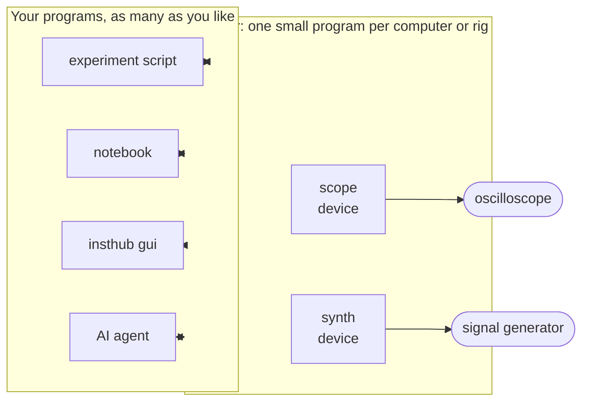

<p align="center">
  
</p>

<h1 align="center">insthub</h1>

<p align="center">
  <b>Share your lab instruments between experiment scripts, notebooks, live plots and AI agents,<br>
  all at the same time, without them getting in each other's way.</b>
</p>

<p align="center">
  <a href="#install">Install</a> ·
  <a href="#try-it-without-hardware">Try it</a> ·
  <a href="#put-your-instrument-on-it">Your instrument</a> ·
  <a href="#the-window">The window</a> ·
  <a href="#ai-agents">AI agents</a> ·
  <a href="#documentation">Documentation</a>
</p>

An oscilloscope, a signal generator or a camera can talk to only one program at
a time. With insthub, one small program, a **server**, holds the connection to
each instrument, and every other program asks it. Your experiment script, a
notebook, a live plot and an AI agent can then all use the same instrument at
once.



## What you get

- **A remote instrument reads like its local driver.** `scope.measure("VPP")`
  and `synth.frequency = 2500` work from any program. Errors arrive as the
  exceptions the driver raised.
- **Your drivers stay as they are.** An existing driver class goes on the bus
  with one line of Python or four lines of config.
- **Live data.** A device can publish traces, images and readings as they
  come. A display always gets the newest one; a recorder can get all of them.
- **No waiting unless you want to.** Every call can also return at once and
  deliver its result later, so one script can drive several instruments at
  the same time.
- **Fast.** A call between two programs takes about 12 microseconds, and
  arrays move at about 10 GB/s, sent straight from memory.
- **Nothing else to run.** There is no central service. Each server stands
  alone, and insthub knows nothing about any particular instrument.
- **A window for all of it.** `insthub gui` shows every instrument as a tile
  with a live preview, and sets up new servers for you.
- **Devices say what they take.** A setting can carry its unit, limits and
  choices, and a command can be marked dangerous. The window then shows a
  spin box with the unit or a list, and asks before anything dangerous;
  agents read the units and need a tool of their own for what is dangerous.
  A simulator says so, and is marked SIM everywhere.
- **Extensions.** An instrument's project offers its devices, and its own
  windows for them, with one small file, `insthub-extension.toml`. `insthub
  ext add` it, and the window's New server lists its devices, ready to run in
  the project's own Python; a device's page then has a button for each of its
  windows (`insthub open DEVICE` does the same). `insthub check` says what is
  wrong with one.
- **AI agents, in plain sight.** Claude Code or any agent that speaks MCP can
  read your instruments' documentation and use them, and the window shows
  when one does.

## Install

You need Python 3.11 or later.

Into the environment that has your instruments' drivers, because that is
where their servers run:

```bash
pip install "insthub @ git+https://github.com/tim4431/insthub"
```

That needs only `numpy` and `msgpack`. Then, once, the `insthub` command for
yourself, in every folder: for the window, the command line and AI agents. The
extras add Qt for the window and live plots (`gui`) and matplotlib for the
plots agents get (`mcp`):

```bash
uv tool install "insthub[gui,mcp] @ git+https://github.com/tim4431/insthub"    # or, from a checkout you work on:
uv tool install --editable "/path/to/insthub[gui,mcp]"
```

A server that shows a window of its own (see `examples/04_server_with_gui.py`)
needs the `gui` extra in its environment too.

[The insthub command for yourself](docs/running-servers.md#the-insthub-command-for-yourself)
explains why there are two installs.

## Try it without hardware

```bash
insthub sim                          # terminal 1: a simulated scope, generator, camera and spectrum analyzer
insthub gui                          # terminal 2: every device as a tile
```

The command line works on the same instruments:

```bash
insthub list                         # what is running
insthub call scope measure VPP
insthub set synth frequency 2500
insthub watch scope ch1              # the live trace, as text
insthub view scope                   # the live trace, as a plot
python examples/03_experiment.py    # a script that uses several at once
```

## Put your instrument on it

**With your existing driver**, in a config file `lab.toml`:

```toml
[devices.psu]                       # the device is called "psu"
driver = "mydriver:PowerSupply"     # your driver class, as it is
path = "~/Code/mydriver"            # where its module is
port = "/dev/ttyUSB0"               # passed to its constructor
```

Start it with `insthub serve lab.toml`. You do not even have to write the
file: in `insthub gui`, **Add → New server...** writes it for you, reading the
arguments your driver takes from its source, and **⋯ → Edit lab.toml...**
changes it later, keeping your comments. [Adding an instrument](docs/adding-a-device.md)
walks through it step by step, with every key of the file.

**Or as a device of its own**, in one file:

```python
import insthub

class Thermometer(insthub.Device):
    def open(self):                          # connect to the instrument here
        self.offset = 0.0

    @insthub.command
    def read(self) -> float:
        """Temperature in kelvin."""
        return 293.15 + self.offset

    @insthub.periodic(1.0)                    # once a second, by itself
    def _poll(self):
        self.publish("temperature", self.read())

insthub.serve(Thermometer("thermo"))
```

**Then, from any other program** on the same computer:

```python
import insthub

thermo = insthub.device("thermo")             # found by name
print(thermo.read())                         # ask and wait
future = thermo.read.future()                # ask, and collect the answer later
for frame in thermo.subscribe("temperature"):
    print(frame.data)                        # arrives by itself, once a second
```

To keep a server running in the background, starting at every login, use
`insthub service install lab.toml`, or **Add → Keep a server running...** in
the window. See [running servers](docs/running-servers.md).

## The window

`insthub gui` shows the instruments of this computer, and of other computers
you list:

- **Devices**: every instrument as a tile. Each tile says whether the
  instrument is connected (and if not, why), shows a live preview of its
  trace, image or reading, and who is watching it. Click a tile to read and
  set its properties, run its commands, switch its periodic tasks, open live
  plots or a window its extension provides, or **Pause** it: everything
  stays off the instrument until you resume it, while you use it by hand.
- **Servers**: start, stop and restart them, read their logs, choose whether
  each starts at login, edit their config, and see which programs are
  connected.
- **Add**: write the config of a new server by picking its drivers (or the
  devices your extensions offer), keep a server running in the background, or
  add the devices of another computer.
- **Settings**: light or dark, or the same as the desktop; your extensions,
  and what is wrong with them.

Closed, it keeps watching from the tray and tells you when something breaks.
`insthub gui --install` puts it in the applications menu. The window is an
ordinary client: it never waits for an instrument, and opening or closing it
changes nothing for your servers. More in [the guide](docs/guide.md#the-manager-window).

## AI agents

```bash
claude mcp add --scope user insthub -- insthub mcp     # with the insthub command installed for yourself
```

Claude Code (or any agent that speaks MCP) can then list the instruments, read
their documentation from your docstrings, call commands, set properties and
take live traces, with large arrays handed over as files. What a device marks
dangerous needs a separate tool, `call_dangerous`, so you can let the agent
use everything else without being asked. The **AI agents** page of `insthub
gui` does this setup with a click and shows which agents are connected. See
[AI agents](docs/agents.md).

## Documentation

| Read this | To learn |
|---|---|
| [How insthub works](docs/architecture.md) | the pieces, what happens during a call and a stream, how programs find each other, what happens when things break, how the window is built, and why it is built this way |
| [Adding an instrument](docs/adding-a-device.md) | putting your instrument on the bus step by step: the config file and every key in it, trying it, keeping it running, changing it later, what to do when it does not work |
| [Using insthub](docs/guide.md) | writing devices, putting existing drivers on the bus, calls, streams, errors, GUIs, the window, the command line |
| [Running servers](docs/running-servers.md) | starting servers, keeping them running in the background, who sets up what, several computers |
| [AI agents](docs/agents.md) | letting Claude Code or another agent use the instruments: setup, the tools, what comes back |
| [Design](docs/design.md) | the rules every change follows, extensions (an instrument's driver and UI in one folder, each run where its libraries are), and what we learned from other lab-control projects |
| [examples/](examples/) | four runnable examples, all on simulated instruments |

## Status

- 417 tests cover calls, streams, device lifecycle, finding servers,
  reconnecting, mixed insthub versions, the command line, config files,
  services, extensions, the GUIs, the agent interface, and how little
  `import insthub` loads. Run them with `python -m pytest tests` (about 30 s).
- Developed and tested on Linux with Python 3.11, 3.12 and 3.14. Written to
  run on Windows, but never run there.
- Not included: passwords or encryption for network connections, clients for
  languages other than Python, and a way to cancel a command that an
  instrument is already carrying out.

## License

MIT, see [LICENSE](LICENSE).

<details>
<summary><b>Layout of the code</b></summary>

```
insthub/
  device.py     Device, @command, @prop, @periodic, wrap; the per-device thread
  server.py     Server; connections; sending without ever waiting for a client
  client.py     connect, device; proxies, futures, subscriptions, reconnecting
  codec.py      what can be sent, and how it is packed
  wire.py       the layout of a message on a connection
  registry.py   finding servers by name
  config.py     servers from a TOML file
  service.py    insthub service: background services
  qt.py         helpers for Qt GUIs             viewer.py   the generic live viewer
  mcp.py        insthub mcp: the bus for AI agents
  render.py     results as JSON plus files and plots, for agents
  manager.py    insthub gui: the window (refreshing, navigation, actions), the tray icon
  pages.py      what each page of it shows      forms.py    its dialogs that set things up
  inventory.py  what it knows of servers and devices, and how it asks them (no Qt)
  widgets.py    its look: colours, icons, tiles  launcher.py its launcher icon
  sim.py        simulated instruments           bench.py    insthub bench
  cli.py        the insthub command
docs/           the pages above
examples/       runnable examples
tests/
```

</details>
