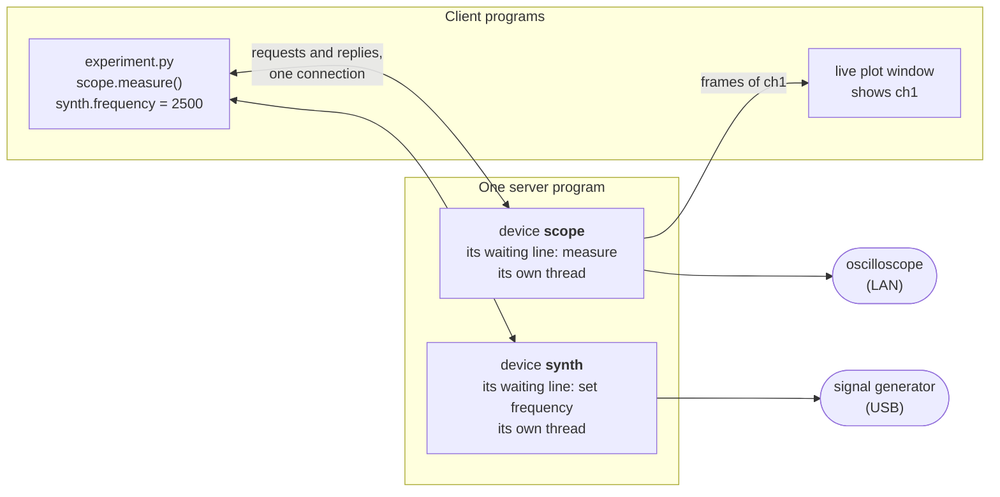
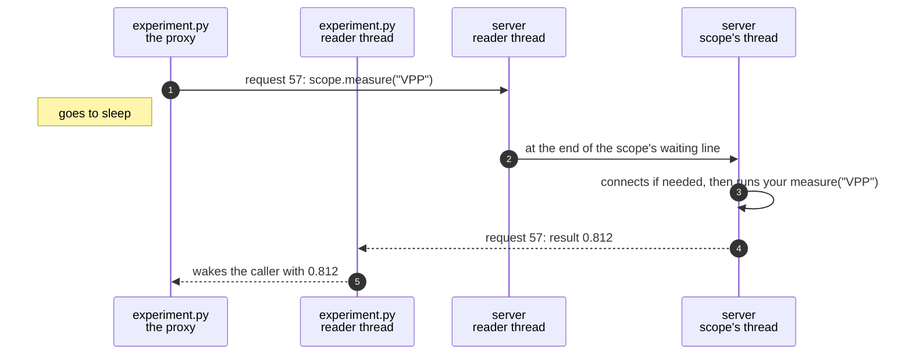
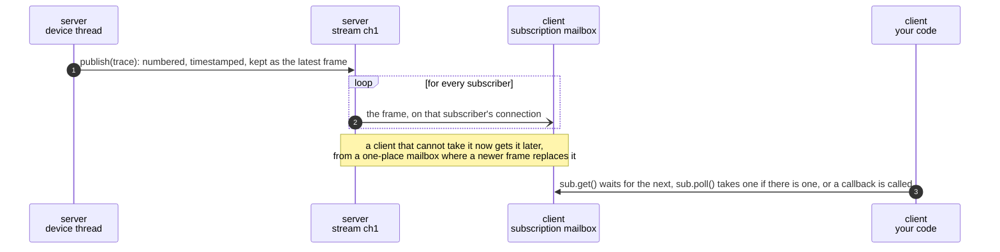
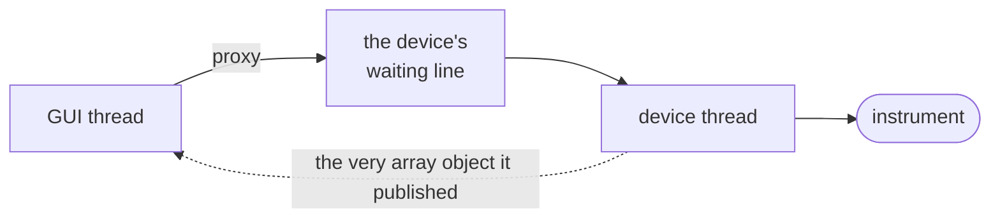
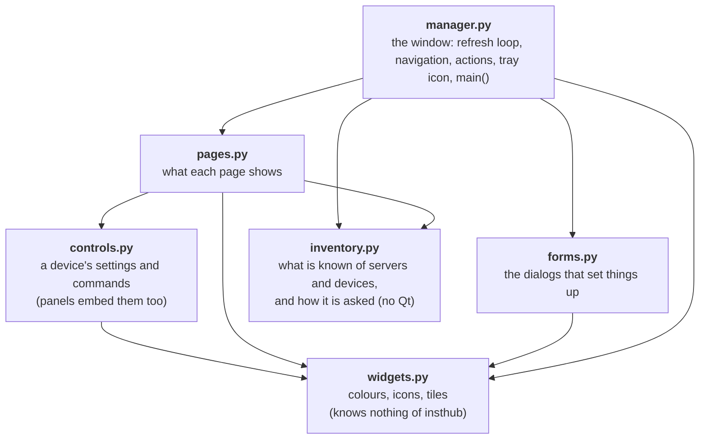
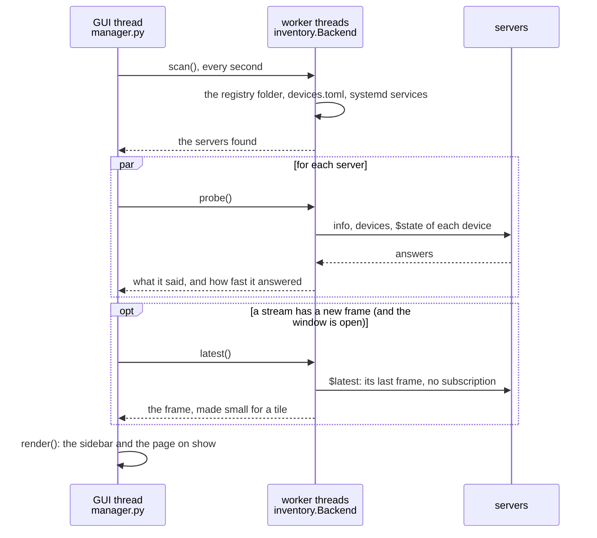

# How insthub works

This page explains what happens inside insthub: the pieces, what happens during
a call, what happens when a device publishes data, how programs find each
other, what happens when something breaks, and how the manager window is
built. It assumes you write Python and know your instruments; it does not
assume any networking background. The diagrams are Mermaid, drawn from their
text by GitHub and most Markdown viewers.

For how to *use* insthub, read the [guide](guide.md). For how to keep servers
running, read [running servers](running-servers.md).

## The problem

Lab instruments share three awkward properties.

1. **One owner at a time.** A serial port, a GPIB address or an instrument's
   LAN port is a single conversation. If two programs talk on it at once, their
   commands interleave and each reads the other's reply. Some instruments
   simply refuse a second connection.
2. **They are slow.** A query takes milliseconds, a sweep takes seconds. A
   program that waits for each instrument in turn spends most of its time
   waiting.
3. **Several programs want them at once.** The experiment script sets and
   reads. A window shows the live trace. A notebook is open for poking around.

insthub answers all three the same way: for each instrument, exactly one program
holds the connection, and everything else asks that program.

## Words used here

| Word | Meaning |
|---|---|
| **Program** (process) | One running `python something.py`. Two terminals are two programs. They share nothing unless they are connected. |
| **Thread** | One line of execution inside a program. A program can have several, working side by side. |
| **Device** | A Python object that holds the session with one instrument. You write it, or insthub wraps your existing driver class. |
| **Server** | A program that hosts one or more devices and answers requests for them. It is a program, not a machine: one PC can run several. |
| **Client** | Any program that uses a device: an experiment script, a notebook, a GUI. |
| **Proxy** | What a client gets from `insthub.device("scope")`. It has the same methods as the device, but each method sends a request to the server instead of doing the work itself. |
| **Command** | A method of a device that clients are allowed to call. |
| **Stream** | A named channel on which a device publishes data on its own initiative, for example `"ch1"` or `"image"`. |
| **Frame** | One published value of a stream, with a running number and a timestamp. |
| **Future** | A placeholder for a result that does not exist yet. You get it at once and ask it for the result later. |
| **Connection** | An open two-way channel between two programs, like a phone line that stays open. The operating system provides it; its technical name is a *socket*. |

## The whole picture



Three rules explain most of the design:

1. **Only a device's own thread ever talks to its instrument.** Your driver
   code runs on that one thread, so it needs no locks and can never be
   interrupted halfway through a command by another caller.
2. **Requests for one device wait in a line** and are served in the order they
   arrived.
3. **Every device has its own line and its own thread.** A scope that takes
   five seconds to trigger does not hold up the generator.

## What happens during a call

Take `vpp = scope.measure("VPP")` in an experiment script, with the server in
another program on the same PC.



1. The proxy packs the request, numbers it 57, sends it and goes to sleep.
2. A reader thread of the server unpacks it and puts it at the end of the
   scope's waiting line.
3. The scope's thread takes it, makes sure the instrument is connected, and
   runs your method `measure("VPP")`.
4. The result is sent back, numbered 57 like the request.
5. A reader thread of the script sees 57, finds who is waiting for it and
   wakes them with 0.812.

Steps 1, 2, 4 and 5 are insthub and take about 12 microseconds together. Step 3
is your instrument and takes however long it takes.

A few things follow from this picture.

- **Many requests can be under way on one connection.** Each carries a number,
  and the reply carries the same number, so replies may come back in any
  order. This is why one connection per server is enough, however many threads
  and devices use it.
- **`scope.measure.future("VPP")`** is the same, except that step 1 does not go
  to sleep. You get a future immediately and collect the result when you want
  it. This is how one script works with several instruments at the same time.
- **`scope.measure.notify("VPP")`** sends the request and asks for no reply at
  all. Steps 4 and 5 do not happen.
- **If your method raises an exception**, step 4 sends the exception instead of
  a result, and step 5 raises it in the caller. A `ValueError` on the server
  arrives as a `ValueError` in the script, with the server's traceback
  attached.

## What happens when a device publishes

Calls are the client asking. Streams are the device telling, without being
asked. A device publishes with one line:

```python
self.publish("ch1", trace, dt=1e-6)      # inside the device, e.g. in a periodic task
```



The important behaviour is what happens to a reader that is slower than the
publisher:

| | the frames, by number | |
|---|---|---|
| the device publishes, 20 per second | 1 2 3 4 5 6 7 8 | |
| a fast reader gets | 1 2 3 4 5 6 7 8 | |
| a slow reader gets | 1 · · 4 · · 7 · | always the newest; `sub.dropped` counts the rest |
| a reader with a queue gets | 1 2 3 4 5 6 7 8 | later, but all of them, in order |

By default a subscription holds one frame, the newest. That is what a live
display wants: the present, not a growing backlog. A recorder that must not
lose anything asks for a queue (`subscribe("ch1", queue=1000)`).

Two more details:

- **A device never waits for a subscriber.** A frozen window or a slow network
  link cannot slow down the instrument or the other clients.
- **Publishing to nobody costs almost nothing** (less than a microsecond). A device
  can also ask `self.subscribers("ch1")` and skip an expensive readout that
  nobody is watching.

## What a device says about itself

Any client can ask a device to describe itself (`$describe`), and every
generic tool is built on the answer: `insthub info`, the window's device
page, the AI agents' tools. The answer holds:

| Part | What it says |
|---|---|
| `commands` | each command's signature and docstring; optionally `params`, the metadata of its parameters, and `dangerous` |
| `properties` | each property's docstring and whether it can be written; optionally `meta` and `dangerous` (writing it is) |
| `streams`, `tasks`, `status` | its streams with their last frame, its periodic tasks, whether it is connected |
| `extension`, `extension_version`, `simulated` | optionally, what the device is: the extension it belongs to, and whether it talks to a simulator |

*Metadata* has five words: `unit`, `min`, `max`, `step` and `choices`
(`device.META_KEYS`). It is advice for whoever shows or chooses a value, never
checked by insthub: an instrument that also takes `"auto"` still gets it, and
the driver stays the place that refuses what is out of range. The device page
picks its controls from it, and agents read units instead of guessing them.

*Dangerous* marks what can harm the instrument, the sample or a person. The
window asks before it runs; the agents' tools refuse it unless the agent uses
the one tool for it, `call_dangerous` (see [agents](agents.md#dangerous-commands)).

Every one of these keys is optional, and only there when it says something.
A client older than them ignores them, and a newer client reading an older
server simply finds none.

## Where the programs are, and how they reach each other

There are three situations, and client code is the same in all of them.

| Client and server are | How they are connected | Does data leave the computer? |
|---|---|---|
| the same program | not at all: the proxy puts requests straight into the device's waiting line | no |
| two programs on one computer | a *Unix socket*: a connection inside the operating system, named by a file | no |
| programs on two computers | a *TCP* connection over the network, only if the server was started with `tcp=` | yes |

So a socket is not the same thing as Ethernet. It is the operating system's
word for a connection between two programs. Only the third kind travels over a
cable.

This is separate from how the server reaches the instrument. That link (USB,
serial, GPIB, the instrument's LAN port) belongs to your driver, and insthub
never sees it.

### Finding a device by name

There is no central directory service. Each server announces itself with two
files in a folder that belongs to your user account (`$XDG_RUNTIME_DIR/insthub`;
without `XDG_RUNTIME_DIR`, `/tmp/insthub-UID`, which insthub refuses if another
account made it or may write to it):

```
  /run/user/1000/insthub/
      scopes.sock      the Unix socket of the server "scopes"
      scopes.json      who it is: process id, addresses, device names ["rigol", "siglent"]
      rf.sock
      rf.json                                                   ["synth", "sa"]
```

The `.json` file also says two things that only programs on this computer
need, so the server never sends them over the network: the Python it runs in,
and for each device the folders its code comes from. From those folders, the
window and `insthub ext list` find the device's
[extension](design.md#how-a-device-finds-its-extension).

`insthub.device("synth")` looks, in this order:

1. at servers inside the same program,
2. through the `.json` files of that folder, for a server that lists `synth`,
3. in a small table you write by hand for devices on other computers
   (`~/.config/insthub/devices.toml`),
4. by asking the servers on other computers that this table names which
   devices they have (each gets about a second to answer, on a connection
   closed at once, and the answers are kept for a few seconds). A server that
   two addresses reach, or a server of this computer named by its network
   address, is one server: it is recognised by its name, pid and start time,
   not by its addresses, since a server elsewhere may announce the very
   addresses of one here (`tcp://127.0.0.1` and the same port). One
   function, `registry.remote_addresses()`, lists those servers, for this
   lookup and for everything else that looks beyond this computer
   (`insthub list`, `insthub.states()`, the window, the agents'
   `list_devices`).

It then opens one connection to that server and keeps it. Asking for a second
device of the same server reuses the connection.

If a server is killed without a chance to clean up, its files stay behind. The
next lookup notices that the process is gone and deletes them.

### The same program: a shortcut

A server can run inside the program that uses it, for example a GUI that both
owns the instrument and displays it. Then there is no connection and nothing is
packed or copied:



You get the same array the device made, not a copy. Treat it as read-only.

## Threads: who does what

Inside a server:

| Thread | How many | What it does |
|---|---|---|
| device thread | one per device | everything that touches the instrument: opening, closing, commands, properties, periodic tasks |
| listener | one per way of being reached (the Unix socket, a TCP port) | accepts new connections |
| reader | one per connected client | reads requests and puts each into the right waiting line |
| writer | at most one per connected client, created only when needed | finishes sending to a client that cannot take data fast enough |
| main thread | one | waits for Ctrl-C, or runs the window of a GUI server |

Inside a client: your own threads, one reader per connection, and one thread
per subscription that uses a callback.

**Periodic tasks** deserve a note. A method marked `@periodic(0.1)` runs on the
device thread every 0.1 s, *between* requests. It is how a device acquires and
publishes continuously without a second thread fighting over the instrument.
A waiting request is always served before the next run of a task, so a busy
acquisition loop does not make commands sluggish. A device's `poll` (`{"temperature":
1.0}`, also from a config file) makes such tasks without a method: `poll:temperature`
reads the property and publishes the value on the stream of the same name.

**Commands marked `concurrent=True`** are the one exception to the waiting
line. They only read values the device has already cached, so they are answered
immediately by the reader thread, even while the device thread is in the middle
of a long sweep.

## When things go wrong

| What happens | What insthub does | What your code sees |
|---|---|---|
| A command raises an exception (bad argument, instrument error). | Sends it back. The device carries on. | The same kind of exception, with the server's traceback. |
| The instrument stops answering (timeout, cable pulled). | Closes the session. The next command opens a new one, but never sooner than `reconnect_interval` (1 s) after the previous attempt. | The failed call raises. The next call works if the instrument is back. |
| The instrument is off when the server starts. | Starts anyway and marks the device "not connected". | Calls raise `DeviceNotConnected` at once, until it is back. |
| A command takes very long. | Later requests for that device wait in line. Other devices are unaffected. | Nothing, unless you asked for a timeout. Use `.future()` to do other things meanwhile. |
| A client reads a stream too slowly, or freezes. | Keeps only the newest frame for it. Never waits for it. | `sub.dropped` goes up. |
| A client program crashes. | Removes its subscriptions. Requests it had already sent still run. | Nothing. |
| The server program crashes or is restarted. | Nothing can be done from inside. | Calls under way raise `ConnectionLost`. The next call reconnects. Subscriptions resume by themselves when the server is back. |
| Somebody pauses the device (Pause in the window, `insthub pause`, `dev.bus.pause()`). | Refuses every call from then on, lets the command already running finish, then closes the session. Runs none of its commands, properties or periodic tasks until it is resumed. | Calls raise `DevicePaused` (a `DeviceNotConnected`) at once. `pause()` itself returns once the running command has finished. |
| The server is stopped (Ctrl-C, or its service is stopped). | Lets the running command finish, cancels the ones still waiting, closes every instrument. | Waiting calls raise an error. |
| Something fails inside the server where no caller sees it (a periodic task, a lost instrument, a thread of the driver). | Logs it, and keeps the last 1000 log lines of its process in memory. | `insthub logs SERVER`, from any computer, or **Logs** in the window. |
| A service's server crashes again and again. | systemd restarts it 5 s later each time, and gives up after 5 starts within 5 minutes. | The service is *failed*; `insthub service list` says how often it was restarted. |

Two promises are worth spelling out:

- **A request is never run twice.** If a connection breaks after a request was
  sent, insthub does not know whether it ran, so it reports `ConnectionLost`
  rather than sending it again.
- **A timeout on the client does not stop the instrument.** `with_timeout(5)`
  only stops the waiting. The command keeps running on the device, and later
  requests still wait behind it.

## What travels on a connection

Every message has three parts:

| 16-byte header | small packed description | raw array memory, if any |
|---|---|---|
| kind of message, its number | names, numbers, text | exactly the bytes of the numpy arrays |

The middle part is [MessagePack](https://msgpack.org), a compact binary cousin
of JSON. Arrays larger than about 2 kB are not put into it. They are sent
straight from the array's memory, and on the other side they are received
straight into the array that is handed to your code. An array is therefore
never converted to text and never copied by Python on the way.

Besides plain values and arrays, tuples, sets, complex numbers and dataclasses
survive the trip as what they were. The exact list is in the
[guide](guide.md#what-can-be-sent), and the byte layout is at the top of
`insthub/wire.py`.

A connection starts with the bytes `INSTHUB1` from both sides, then the
server's *hello*: its name, process id, devices, the protocol number, the
insthub version it runs and its *features*, a list of what it can do beyond
the first version of the protocol (`"pause"`, `"meta"`, `"dangerous"`, `"logs"`). A
lab runs several insthub versions at once (servers started before a `git
pull`, other computers), so:

- a program asks before it uses something newer:
  `insthub.connect(address).supports("pause")`. An older server has no list,
  so the answer is no;
- a server or client that receives a kind of message it does not know skips it
  and carries on, instead of closing the connection.

## How fast it is

Measured with `insthub bench` on a 32-core Linux PC (Python 3.12) on 2026-11-24.
Except in the first column, the server is a separate program.

| | same program | Unix socket | TCP on one PC |
|---|---|---|---|
| one call through the device thread | 5 µs | 12 µs | 14 µs |
| one call answered at once (`concurrent=True`) | 1.5 µs | 10 µs | 12 µs |
| many calls sent ahead as futures | 320 000 /s | 220 000 /s | 130 000 /s |
| a 100 MB array there and back | not copied | 19 ms (10.7 GB/s) | 18 ms (11.2 GB/s) |
| stream of 1000-point traces | 370 000 frames/s | 230 000 frames/s | 190 000 frames/s |
| stream of 8 MB images | not copied | 1100 frames/s | 1400 frames/s |

An instrument answers in milliseconds, so for a single command the bus is not
what you wait for. Its speed matters for large data, for many small calls, and
for streams.

## Inside the manager window

`insthub gui` is an ordinary client: it talks to the servers the way a script
does, so closing it (or it crashing) changes nothing for them. It is built in
four layers, each knowing only the ones below it (an arrow means "uses"):



Its GUI thread never waits for a server. Once a second (every 3 s while only
the tray icon is watching) it asks its worker threads to look again, and draws
what comes back:



- **A tile's preview** is the last frame of the device's first stream, fetched
  with `$latest`. That is no subscription: a device that only reads out while
  somebody watches (`self.subscribers("ch1")`) stays idle, and the window is
  not counted among its watchers.
- **Properties** are read only when a device's page opens, and **commands** run
  only when you ask. Both wait in the device's line like any other request.
  The control for each property, and the hints under a command, come from the
  device's description (its metadata), not from reading the instrument. These
  two tabs are `insthub.controls`, which a panel can embed too: there they
  call through the device's proxy, and in the window through its worker
  threads.
- **Live view** opens `insthub view` as a program of its own.
- **Extensions** are read, never run: the New server dialog and the Settings
  page list the devices of the manifests that `extensions.discover()` finds,
  on a worker thread (it asks systemd about services). The window imports no
  extension's code; the server it starts does, in the extension's Python.
- **Open** on a device's page starts a UI of the device's extension
  (`extensions.launch`) as a program of its own, with the extension's Python:
  an app, or a panel that `insthub panel` puts in a window (one button, or
  one with a menu of them when there are several). Which UIs a server's
  devices have is found out on a worker thread, for all of them at once
  (`extensions.server_uis`, from the folders in its server's `.json` file
  when the server runs here), after a probe or when the page opens, at most
  every 30 seconds unless the devices or their extensions change.
- **What the window starts** (servers, the live view, UIs) runs in a session
  of its own, so it outlives the window, and writes its output to a log file
  in the runtime folder (`inventory.spawn`). When one of them ends with an
  error, the window shows the last lines of its log.

## Why it is built this way

**Why one thread per device, instead of a lock around the driver?**
A lock keeps two callers apart but says nothing about order, and it gives a
background acquisition loop no fair way in. A waiting line gives order for
free, lets periodic tasks run in the gaps, and keeps everything for one
instrument on one thread, which some vendor libraries require.

**Why threads and not `asyncio`?**
Instrument libraries (pyvisa, pyserial, GPIB, camera SDKs) block while they
wait. With threads, driver code stays ordinary Python. Clients that do use
asyncio can still `await` any call.

**Why no central server that all others register with?**
It would be one more thing to start first and one more thing to fail. Without
it, each server works alone, and finding one is a matter of reading a file.

**Why not HTTP and JSON, which any language can speak?**
JSON has no way to carry an array except as text, which makes large data slow,
and HTTP has no natural way for the server to send data without being asked,
which streams need. The cost is that clients exist only for Python so far.

**Why MessagePack and not Python's `pickle`?**
Unpickling data from a connection can run arbitrary code. insthub only ever
rebuilds a fixed set of plain types, plus dataclasses your own program has
already defined.

**Why does a stream skip frames by default?**
Because the usual reader is a display, and a display that falls behind is
worse than one that skips. Lossless delivery is one argument away
(`queue=N`).

## What insthub does not do

- It does not know any instrument. Protocols, command strings and vendor
  libraries stay in your drivers.
- It does not set up the operating system for hardware (permissions, kernel
  drivers). See [who sets up what](running-servers.md#who-sets-up-what).
- It has no authentication or encryption. Keep TCP on a trusted network.
- It cannot cancel a command that is already running on an instrument.
