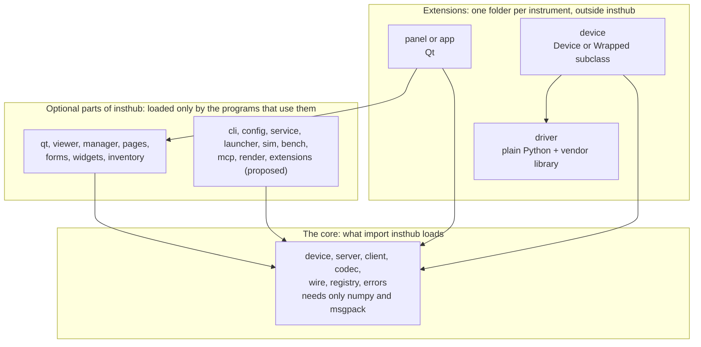
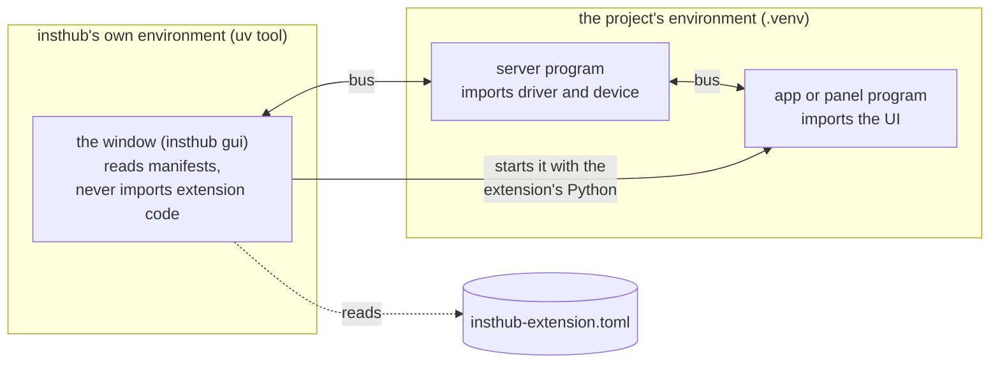

# Design

This page is for whoever changes insthub, people and AI agents alike. It
states the three rules every change is judged by, the extension model that
follows from them, what we took from eleven other lab-control projects, and
the ideas we decided against, with the reasons.

For how insthub works today, read [how insthub works](architecture.md). Much
of this page is a plan: sections marked *proposed* describe plans, and the
rest describe insthub as it is.

- [The three rules](#the-three-rules)
- [Where code lives](#where-code-lives)
- [Extensions](#extensions) (proposed; a device already says what it is)
- [A generic UI good enough for most devices](#a-generic-ui-good-enough-for-most-devices)
- [Keeping the core light](#keeping-the-core-light)
- [The plan, in order](#the-plan-in-order)
- [What we learned from other projects](#what-we-learned-from-other-projects)
- [Ideas we decided against](#ideas-we-decided-against)
- [Open questions](#open-questions)

## The three rules

**1. insthub knows no instrument.** Nothing in insthub is about a particular
scope, synthesizer or camera: no command strings, no vendor libraries, no
"if this is a Rigol". insthub knows *kinds* of things: devices, commands,
properties, streams, units. It never knows *which* instrument it is talking
to. The one exception is the simulated instruments of `insthub sim`: generic
test instruments with no vendor code, loaded only by `insthub sim` and the
tests.

**2. Everything about an instrument belongs in an extension.** An extension
holds a device's driver and, if it has one, its user interface, the way a VS
Code extension can hold both a language server and the views that show its
results. insthub will provide the framework that finds extensions, joins
their parts and runs each part in the right place (see
[Extensions](#extensions), proposed). The smallest extension is a driver
class and four lines of config.

**3. insthub stays light, because everything imports it.** Every driver
server, experiment script, notebook and GUI in the lab runs `import insthub`.
So each dependency, each millisecond of import time and each new concept is
paid in every one of them. Heavy things (Qt, plotting, and
`importlib.metadata`, which reads what packages are installed) stay optional
and load only in the programs that use them.

What these rules mean in practice:

| When you are about to... | Ask |
|---|---|
| add a feature | Could an extension do this instead? If only one instrument needs it, it belongs in that instrument's extension. |
| add a dependency | Would `import insthub` load it? Then don't add it: put it in an extra (`gui`, `mcp`) or in a module imported only where it is used. |
| add a key to `describe()` | Is it generic (a unit, a range) rather than about one instrument? Is it optional, so older programs ignore it? |
| add a concept | Will most users meet it? If not, it must cost nothing until someone uses it. |
| import something at module level in the core | Does every lab program need it? If not, import it inside the function that uses it. |

When a change conflicts with these rules, change this page first, on purpose,
rather than letting the code drift.

## Where code lives

There are three places. Code may use code in its own place and in the places
below it, never above. An arrow means "uses".



| Place | Loaded by | May depend on |
|---|---|---|
| **Core** | every lab program | the standard library, numpy, msgpack |
| **Optional parts of insthub** | the `insthub` command, the window (`insthub gui`), the MCP server, servers started from a `.toml` | the core, plus their extra (`gui`: Qt and pyqtgraph; `mcp`: matplotlib) |
| **Extensions** | the server that hosts the device, and the program that shows its UI | insthub, plus whatever their instrument needs |

An extension mechanism must keep this true.

## Extensions

*Status: proposed, except that a device already says which extension it
belongs to and whether it is simulated (`extension`, `extension_version` and
`simulated` in `describe()`; see [how a device finds its
extension](#how-a-device-finds-its-extension)). Manifests, finding extensions
and starting their UIs are not implemented yet. Today an instrument's project
puts its driver on the bus with a `bus_server.py` or a `.toml`, and a
device-specific GUI is a separate program. Examples are the lab's own
instrument projects, folders beside insthub: `hp_8562a_gpib`,
`windfreak_sythHDprov2`, `m8195a_ripa` and `oscilloscopes`.*

### What an extension is

An extension is a folder for one instrument or one family of instruments. It
may also be an installable Python package, but it does not have to be. It
holds:

- a **driver**: plain Python and the vendor library, with no insthub in it
  (see [rules inside an extension](#rules-inside-an-extension)).
- a **device**: a `Device` or `Wrapped` subclass that puts the driver on the
  bus. Or no class at all: the driver wrapped from a `.toml`.
- optionally a **simulator**: a fake driver, or the device with `sim=True`.
- optionally a **UI**, in one of two forms. A *panel* is one widget, and
  insthub puts it in a window. An *app* is a whole program with its own
  window.
- one small file, **`insthub-extension.toml`**, the *manifest*, that names all
  of the above.

Other projects say plug-in or add-on. This page says *extension* for
insthub's.

```
hp8562a/                          the project folder, with its own .venv
    insthub-extension.toml        the manifest: names everything below, by strings
    hp8562a.py                    the driver (its name is unique, so it may stay at the top)
    hp8562a_sim.py                a simulated analyzer, for tests and demos
    hp8562a_insthub/              everything with a generic name goes in a package of its own
        __init__.py               imports nothing heavy
        device.py                 class SpectrumAnalyzer(insthub.Wrapped), with extension = "hp8562a"
        ui/
            __main__.py           the app:   python -m hp8562a_insthub.ui --address ADDR --name NAME
            panel.py              the panel: make(device, parent=None) -> QWidget
    pyproject.toml                optional (rule 5 below)
```

### Two halves, each where its libraries are

The deciding fact is that **the parts of a lab run in different Python
environments**. Each instrument's project has its own `.venv`, with its vendor
library and `-e ../insthub`. The `insthub` command, and with it the window
(`insthub gui`), runs from its own `uv tool` environment, which has no
drivers at all (see [the insthub command for
yourself](running-servers.md#the-insthub-command-for-yourself)).

Every project we studied that joins a driver and its UI in one package
(qudi, labscript's BLACS, instrumentserver, nspyre, ScopeFoundry) needs the
UI and the driver installed in one environment, and most load them into one
process. insthub cannot do that without making every lab install every
instrument's libraries into one environment.

So an extension has two halves, and each runs where its libraries are. They
meet over the bus, which is what the bus is for:



- The **server half** (driver, device) runs in the server program, as today.
- The **UI half** (panel, app) runs as a program of its own, started with the
  extension's Python. The window already starts `insthub view` as a program
  of its own, though with its own Python and with its output thrown away. It
  already chooses a project's Python for servers (`inventory.find_python`)
  and writes their output to a log (`inventory.spawn`). Starting an app
  combines the two.
- The **window** reads manifests as data and starts programs. It never
  imports an extension's code. A crashing or hanging vendor UI therefore
  cannot take down the window, its tray icon or its probing of other servers.

VS Code extensions do the same with language servers: the extension starts a
separate program, in whatever runtime that program needs, and talks to it
over a protocol. In insthub the protocol is the bus.

The UI half reaches its device only through a device proxy, never by calling
the driver. So it can do nothing a script could not do, and it works on any
computer with `insthub[gui]` and the extension installed.

### The manifest

`insthub-extension.toml` is data. insthub reads it with `tomllib` and never
runs it, so listing extensions never imports a vendor library. A manifest
lists what the extension adds to insthub, in two kinds of table: `devices`
and `ui`.

```toml
[extension]
id = "hp8562a"                        # what this extension's devices announce (see below)
title = "HP 8562A spectrum analyzer"
version = "0.3"
api = 1                               # the version of this file's format
# python = ".venv/bin/python"         # default: a .venv in this folder or the one above

[devices.analyzer]                    # offered by the window's New server dialog
driver = "hp8562a_insthub.device:SpectrumAnalyzer"
doc = "HP 8562A over GPIB (linux-gpib)"

[devices.analyzer-sim]
driver = "hp8562a_insthub.device:SpectrumAnalyzer"
doc = "a simulated analyzer, no hardware needed"
sim = true                            # every other key goes into the server file as it is

[ui.analyzer]                         # an app: a whole program, started as <python> <run...>
title = "Spectrum analyzer"
run = ["-m", "hp8562a_insthub.ui", "--address", "{address}", "--name", "{device}"]

[ui.quick]                            # a panel: one widget, in a window insthub provides
title = "Quick look"
panel = "hp8562a_insthub.ui.panel:make"
```

| Table | Used by | What it does |
|---|---|---|
| `[devices.NAME]` | the window's **New server** dialog, `insthub ext list`, `insthub check` | a ready-made `[devices.x]` table for a server file. `driver` names a `Device` subclass or a plain driver class to wrap, exactly as in a server's `.toml`. `doc` describes it. Every other key (constructor arguments, `exclude`, `link_errors`, `lazy`, ...) is copied into the server file as it is. The dialog reads the constructor's arguments from the source without importing it, as it already does, and adds `path` and `extension`. The server it creates runs with the extension's Python. |
| `[ui.NAME]` | the device page's **Open** button, `insthub open DEVICE [NAME]` | with `run`, an app, started as `<python> <run...>`; with `panel`, a panel, put in a window of its own (see [writing the UI half](#writing-the-ui-half)). Offered for every device that belongs to this extension. |

Each module name in a manifest is found with the manifest's folder first on
the module search path. An app or panel starts with that folder as its
working directory and on `PYTHONPATH`, so an extension works as a plain
folder, without being installed. `{device}` and `{address}` in `run` are
replaced by the device's name and its server's address.

A driver class wrapped from a manifest keeps its safety options in its
table. For example, the Windfreak synthesizer's raw protocol methods must
stay off the bus:

```toml
[devices.synth]
driver = "synthhd:SynthHD"
doc = "Windfreak SynthHD over USB"
exclude = ["write", "query", "read_all", "ch_write", "ch_query"]   # "m1" would move control to UART
```

Further kinds of table are reserved, but nothing reads them yet: `match` (how
to recognise the hardware on a scan), `docs` (for people and agents), and
`implements` (a tag saying a device offers a standard set of commands, so one
UI can serve two vendors' instruments). A new kind is added only together
with the code that reads it and a test. A field nothing reads drifts out of
date, as PyroLab's `detect_devices` did.

### How a device finds its extension

*Status: a device saying what it is, below, is implemented (step 4); the
folders in the server's `.json` file and the window's use of them are not.*

A running device says which extension it belongs to:

```python
class SpectrumAnalyzer(insthub.Wrapped):
    extension = "hp8562a"             # just a name: insthub compares it, never interprets it
    extension_version = "0.3"         # optional

    def __init__(self, name=None, board=0, pad=18, sim=False):
        super().__init__(SimHP8562A if sim else HP8562A, name, kwargs={"board": board, "pad": pad})
        self.simulated = sim          # shown as SIM, so simulator output is never taken for a measurement
```

For a driver wrapped from a `.toml`, the keys `extension = "hp8562a"` (and
`simulated = true`) go in its `[devices.x]` table; the New server dialog will
write them. A driver class that has `simulated = True` makes its wrapped
device say so by itself. `describe()` then carries `extension`,
`extension_version` and `simulated` (each only when set), so any client on
any computer can match a device to its UI without importing anything. The
window marks a simulated device SIM on its tile and page, `insthub info` and
the agents' `list_devices` say it, and the device page shows the extension.

These are attributes of `Device`, and insthub reads them without running
anything: a subclass that already uses one of the names for a command or a
property of its own keeps it, and then just declares nothing under it.

Neither the class name nor the module name can do this job. For a `Wrapped`
device the type is the driver's class name, which differs between the real
instrument and its simulator (`HP8562A`, `SimHP8562A`). The module is
`__main__` when a project runs `python bus_server.py`. And matching by the
commands a device happens to have, as `hp8562a_gui` does today with its
`REQUIRED_COMMANDS`, breaks when one is renamed.

To go from a running device to its folder, each server's `.json` file in
insthub's runtime folder (see [finding a device by
name](architecture.md#finding-a-device-by-name)) will list, for each device,
the folder of the file its class comes from (for a `Wrapped` device, the
driver's too), and the server's Python. The window looks for the nearest
`insthub-extension.toml` in that folder or a folder above it. This works
however the server was started: from a `bus_server.py` in another folder,
from a `.toml` the New server dialog wrote into `~/.config/insthub/servers`,
or with devices from two extensions in one server. These two facts go only
into the `.json` file, which only your user account can read. They are never
sent to other computers.

**Security.** A UI is offered when `describe()["extension"]` equals a
manifest's `id`, but only a manifest found on *this* computer can cause code
to run. A remote server sends nothing but the name. Names that arrive over
the network are checked (`registry.check_name`) before they fill a
placeholder, and insthub never runs a module name or command line that came
from another computer.

### Where insthub looks for extensions

For a device on this computer, insthub uses the manifest found from the
device's own folder, as above. **Open** therefore starts the copy of the
extension that its server runs, even when you have two copies (a working copy
and the one a service runs).

Everywhere else (a device on another computer, the New server dialog,
`insthub ext list`), it looks in this order. The first manifest with a given
`id` wins, and `insthub ext list` reports the others as hidden by it:

1. insthub's own manifest, shipped with it. It lists the simulated
   instruments of `insthub sim` and runs with the Python insthub runs in, so
   every run of the test suite exercises the mechanism.
2. folders you add with `insthub ext add PATH` or **Add extension folder** in
   the window, kept in `~/.config/insthub/extensions.toml`. `insthub ext
   remove PATH` and a **Remove** button take them out again.
3. the folders of the installed services' devices: the `path` of each device
   in their server files.
4. the folders of the servers running on this computer, as above.
5. later, installed packages that declare an `insthub.extensions` *entry
   point* (a name a package registers in its `pyproject.toml`, which other
   programs can look up without importing the package). This is for when
   extensions are pip-installed into shared environments.

`insthub serve` never looks for extensions. A server is built from its own
file, so a service does not depend on what one user has listed.

**A device on another computer** gets its UI from a copy of the same
extension on this computer, run with that copy's Python. If there is none,
its page stays generic and says "extension hp8562a is not installed on this
computer: `insthub ext add FOLDER`".

### Installing, updating and broken extensions

insthub installs nothing. An extension is a folder: clone it, make its
environment (for a packaged one, `uv sync --extra gui`), then `insthub ext
add` it. Updating is `git pull`; the window then says which servers run older
code and need a restart. A manifest that cannot be used (it is not valid
TOML, its `api` is too new, its `id` is not a valid name, its Python or its
folder is missing) is listed with its error by `insthub ext list` and in the
window. It never hides the other extensions, and `insthub check FOLDER` says
what to do about it.

### When code is loaded

| What | Imported by | When |
|---|---|---|
| the manifest | the window, `insthub ext`, `insthub check` | to list extensions; it is data, nothing runs |
| the driver and device | the server that hosts the device | when the server builds it (`config.load_object`, as today) |
| the app or panel | the program started for it, with the extension's Python | when someone clicks **Open** |
| `insthub.extensions` itself | the window and the command line | never by `import insthub` |

Unlike VS Code, insthub has no list of events that wake an extension up, and
no long-running program that hosts extensions. "Activating" an extension just
means importing it in the program that needs it.

### Writing the UI half

A panel is one function:

```python
def make(device, parent=None) -> QWidget:
    ...
```

`device` is an ordinary proxy, the same thing `insthub.device(name)` returns.
The panel uses `qt.watch` for streams and `qt.deliver` for results, so it
never blocks the GUI thread. It stops its watchers when its widget closes. It
talks only through commands, properties and streams, so everything it does can
also be done from a script or by an agent. qudi has the same rule: a GUI adds
nothing that the logic's API cannot do.

The same panel can run in two places without change:

- in a window of its own. The window runs `python -m insthub -a ADDRESS panel
  DEVICE MODULE:FUNCTION` with the extension's Python, where the `insthub`
  command itself may not be installed. A small `qt.device_window` helper
  builds the window around the panel. It imports the panel's module before
  `insthub.qt`, so the panel's own Qt binding (PyQt6, PySide6, ...) is the one
  used. This is the default.
- inside an app that hosts its own server in the same process, where frames
  arrive without being copied (as in `examples/04_server_with_gui.py`).

Showing a panel as a tab inside the window is an [open
question](#open-questions).

An app is a whole program, for a device whose UI is a full application. It
takes the device's address and name, and when it is given an address it only
attaches to that device. Otherwise a name that does not resolve at that
moment could make it start a second server for the same instrument.

The window writes an app's output to a log file in insthub's runtime folder.
If the app exits within a few seconds, the window shows the log's last lines,
for example "No module named PyQt6: install the extension's gui extra into
this Python".

The launched program runs the extension's own insthub, which may be older
than the window's. If that insthub has no `panel` command yet, the log says
which version is needed.

### Rules inside an extension

1. **The driver does not need insthub or Qt, and imports cleanly where the
   vendor library is missing.** Import the vendor library in the constructor,
   or guard the import at the top (`try: import gpib` / `except ImportError:
   gpib = None`), as `hp8562a.py` does. A pure-Python library such as pyserial
   can be imported normally. Then the driver can be used from a plain script,
   and tests and `insthub check --import` run without the hardware stack.
2. **The device imports only insthub's core, the driver and the extension's
   own modules.** A server often runs as a background service with no screen,
   so it must not need Qt. `insthub service install` already warns when a
   driver of the server's `.toml` loads Qt, and `insthub check PATH
   --import` will warn when importing the device does. Vendor exception classes for `link_errors` come
   through the driver (for example a `LINK_ERRORS` tuple defined in the
   driver module), or as `"module:Class"` strings in the `.toml`. A `Wrapped` subclass that a
   manifest or `.toml` names defines its own `__init__(self, name=None,
   <the driver's arguments>)` and calls `super().__init__(Driver, name,
   kwargs=...)`, as in the example above. `insthub serve` calls it with the
   table's keys, and the New server dialog shows its arguments.
3. **The UI is the only place for Qt, and it reaches the instrument only
   through a device proxy.** It never calls the driver. An app may also host
   the server half in its own process when no server runs, as `hp8562a_gui`
   does. It then imports the device module only at that point, and it needs
   the project's environment.
4. **Every top-level module name an extension uses is its own.** Generic
   names (`bus_server`, `driver`, `device`, `gui`, `sim`) go inside a package
   such as `hp8562a_insthub`. A uniquely named driver such as `hp8562a.py` may
   stay where it is. Python keeps only the first module of a name, so two
   folders that each have a `bus_server.py` cannot both be loaded into one
   program. For the module that a table's `driver` names, insthub's loader
   reports the collision, naming both files (also for a module inside a
   namespace package, a folder without `__init__.py`, whose folders Python
   merges), instead of failing with a
   misleading "cannot load driver" error or silently using the other
   folder's class when both use the same class name. It cannot see the
   modules a driver imports in turn: two folders whose drivers each import
   a helper `driver.py` or `sim.py` silently share the first folder's
   helper. Only this rule prevents that.
5. **A packaged extension keeps its UI's libraries in an extra**, for
   example `dependencies = ["insthub @ git+...", "pyserial"]` and
   `[project.optional-dependencies] gui = ["insthub[gui] @ git+..."]`. A
   server's environment then installs only the server half. (Libraries that
   come from the system, like linux-gpib's `python3-gpib`, need a venv made
   with `--system-site-packages` instead.)
6. **Mark what is dangerous.** A wrapped driver's raw I/O methods (`write`,
   `query`, ...) are excluded (`exclude`) or marked `dangerous`, and so is
   anything that can harm the instrument, the sample or a person. Agents
   then need `call_dangerous` for it, and the window asks first.

### Versions

| What | How |
|---|---|
| the manifest's format | `api = 1`. insthub refuses a manifest with a higher number and accepts lower ones until one is deliberately dropped. |
| the extension's code | `version` in the manifest, `extension_version` on the device. When the device states one, the window can say "running 0.3, the folder has 0.4: restart", as LabRAD's node does. The New server dialog never writes `extension_version` into a `.toml`, because it would freeze there, and `insthub check` warns when a class's `extension_version` differs from its manifest's `version`. |
| the bus between two programs | Every connection starts with the bytes `INSTHUB1`, so a program that speaks another protocol is refused. The server's first message about itself, the *hello*, carries `protocol`, insthub's `version` and a list of `features` (`server.FEATURES`, today `["dangerous", "meta", "pause"]`), so that a client can ask (`client.supports("pause")`) before it relies on something newer. Both sides skip kinds of message they do not know instead of closing the connection. Together these let a feature arrive without everyone upgrading at once. |
| `describe()` | Keys are only ever added, and they are optional, so older programs ignore them. |

Servers started before a `git pull`, other computers, and projects that
install insthub from git instead of `-e ../insthub` all run other versions.
So a lab must expect several insthub versions at once, and these rules allow
it.

### Existing projects become extensions

Nothing breaks: `driver = "module:Class"` with `path` keeps working, and
every new key is optional. New reserved keys (`extension`,
`extension_version`, `simulated`, `accessors`, `poll`, `meta`, `dangerous`)
do take those names away from driver constructors. A table that has such a
key while its constructor takes a parameter of that name is an error until
`kwargs` says what the constructor gets, so a file that used to pass
`simulated = true` to its driver never silently starts the real instrument.
When the table does not have the key, the loader's error says why it does not
reach a required parameter; `insthub service install` warns about an optional
one.

| Project | Becomes |
|---|---|
| `hp_8562a_gpib` | The reference extension. First, with today's files: a manifest with `driver = "bus_server:SpectrumAnalyzer"`, its simulator, and `[ui.analyzer] run = ["-m", "hp8562a_gui", "--name", "{device}"]`; `SpectrumAnalyzer` gets `extension = "hp8562a"` and `self.simulated = sim`; `hp8562a_gui` learns `--address` and then only attaches. Later, `SpectrumAnalyzer` and the GUI move into `hp8562a_insthub/` (with `bus_server.py` kept as a two-line shim, so services and tests keep working), the GUI matches its device by `extension` instead of `REQUIRED_COMMANDS`, and a panel is offered. |
| `windfreak_sythHDprov2` | A manifest with one device and no UI. The `Synth` class moves into a package of its own (`bus_server.py` stays as a shim). Its settings are per-channel methods (`frequency(ch)`, `set_frequency(ch, mhz)`), not properties, so the generic page serves it through its commands, with units and ranges once command parameters carry metadata. |
| `m8195a_ripa` | Two manifests, one per instrument: `m8195a` in the project folder and `redpitaya` in `tools/redpitaya/`. Each device in `bus.toml` gets its `extension` key. `accessors = true` turns the AWG driver's ~40 argument-free `get_X`/`set_X` pairs into properties; its ~30 per-channel pairs stay commands. Its raw I/O methods are excluded or marked dangerous. |
| `oscilloscopes` | Already a package. It ships its manifest inside the installed package and is the first candidate for finding extensions through entry points. |

## A generic UI good enough for most devices

*Status: implemented (plan steps 5 and 6), as described below.*

The cheapest extension UI is the one nobody has to write. If devices describe
themselves well enough, the generic device page and the AI agent tools cover
most simple instruments. An extension then needs a UI only for what a
generic page cannot show, such as a spectrum with markers or a camera image
with a region of interest. ScopeFoundry builds most of its UIs from typed
settings, and ARTIQ builds its experiment forms from typed arguments.
instrumentserver shows the converse: its descriptions carried no ranges or
choices, and its generic widget never got past a text field.

- **Property metadata.** `@insthub.prop(unit="Hz", min=0, max=26.5e9)`, with a
  fixed vocabulary, `device.META_KEYS`: `unit`, `min`, `max`, `step`,
  `choices`. A misspelled word is a `TypeError` that names the right one. A
  device can change it from `open()` with `self.set_meta("center", max=...)`,
  because limits often depend on which model or option is connected; pages
  see a later change the next time they read `describe()`. `choices` can come
  from a `Literal` or `Enum` annotation (a `bool` needs none: the page shows
  a true or false value as a switch anyway). Wrapped drivers get it from
  `wrap(meta=...)` or the `.toml`. The device page picks a list, a spin box
  with the unit, or a switch, with the text field as the fallback, and agents
  and `insthub info` get the units. It is advice for the UI, not enforced:
  instruments accept values like `"auto"`, and they clamp by themselves.
- **Command parameters** take the same vocabulary
  (`@command(params={"mhz": {...}})`, or `"set_frequency.mhz"` in `meta`), for
  drivers whose settings are methods with arguments, such as a synthesizer's
  `set_frequency(channel, mhz)`. A name that is not a parameter is an error
  when the device's tables are made.
- **Accessor pairs.** `wrap(..., accessors=True)` turns a driver's getter with
  no required arguments (`get_X()`) and its matching `set_X(value)` into a
  property `X`. A getter without a matching setter is left alone, so a
  read-and-clear method like `get_error()` is never read by the device page.
  Both stay commands, and a driver that has a public `X` already keeps it.
- **Polling from the config.** `poll = {temperature = 1.0}` in a `[devices.x]`
  table (or `poll` on the class) reads the property `temperature` (or calls a
  command of that name with no arguments) every 1.0 s, on the device's thread,
  and publishes the value on a stream of the same name. It is a periodic task
  named `poll:temperature`, switchable like any other. An unmodified driver
  then gets live values, tile previews and `insthub view` without a subclass.
- **Dangerous commands.** `@command(dangerous=True)`, `@prop(dangerous=True)`
  (writing it is, so only a property with a setter), or `dangerous = [...]` /
  `true` for a wrapped driver as a whole. The agents' `set` and `call` refuse
  them, including through `$set`, and `call_dangerous` runs them; the window
  asks before running one. A config file's `dangerous` adds to the class's
  marks and never removes one, and the two halves of an accessor pair (`X`
  and `set_X`) are marked together, since they write one setting.

All of these reach clients only through `describe()`, as optional keys
(`meta`, `params`, `dangerous`), and the server announces them as the
features `"meta"` and `"dangerous"`. The tables they live in are made when the
device's runtime is made and again when it is added to a server, so what a
config file sets after the constructor ran counts: a new `dangerous` mark, a
new `poll` entry, and a new interval for one the class already polls (a task
keeps an interval changed at run time only while its declaration stays the
same). A name that the device does not have is reported then: for a wrapped
driver already when the file is checked, since making its device runs none
of the driver's code.

## Keeping the core light

*Status: implemented. `tests/test_footprint.py` enforces the limits below,
and `asyncio` is imported only where it is awaited.*

What `import insthub` may load:

- the standard library, numpy and msgpack;
- `insthub.device`, `server`, `client`, `codec`, `wire`, `registry` and
  `errors`, and `_version`, the one line that holds insthub's version.

What it must not load: Qt in any binding, pyqtgraph, matplotlib,
`importlib.metadata`, `asyncio`, or any of insthub's optional modules
(`config`, `extensions`, `qt`, `viewer`, `manager`, `pages`, `forms`,
`widgets`, `inventory`, `render`, `mcp`, `sim`, `bench`, `service`,
`launcher`, `cli`, `tomlfile`). It must not write a file or open a connection
either.

`import insthub` used to add about 210 modules to a bare Python and take
about 40 ms on the lab PC, half of that numpy. About 6 ms of it was
`asyncio`, which only the asynchronous paths of `client.py` use: `await` on a
call, `aio()`, `aget()` and `async for` on a subscription. That import now
happens in them, and `import insthub` adds about 175 modules.

**A test makes this a rule, not a habit.** `tests/test_footprint.py` imports
insthub in a fresh Python, with its runtime and config folders pointed at an
empty one, and checks the lists above and that the folder stays empty. It
prints the import time rather than failing on it. Several
frameworks we studied got heavier through imports nobody guarded:

- nspyre imports its GUI along with the package.
- PyLabNet's logger pulls in Slack and Qt.
- ScopeFoundry's "pure" driver imports pyqtgraph through a helper.
- labscript connects to a lock server when one of its modules is imported.

ARTIQ later had to split its remote-call layer (sipyco) into a package of its
own, so that small programs could use it without the rest.

More rules:

- New features arrive as optional keys and as modules imported where they are
  used, never as new hard dependencies. For example, `config.py` imports
  `difflib`, for its "did you mean" suggestions, only when there is an error
  to report.
- No lazy imports in `__init__.py` (a module-level `__getattr__` that imports
  a submodule the first time it is used). The core modules import each other
  anyway, so it would save about a millisecond and make the package harder to
  read.
- The window and the MCP server should use only insthub's public API, so they
  could move to a separate package one day. Today `forms.py` and
  `inventory.py` reach into `client._SocketTransport` because `connect()`
  takes no connect timeout; a public `insthub.connect(address, timeout=...)`
  removes that.
- Extensions carry the rule on: their driver and device modules do not import
  Qt (see [rules inside an extension](#rules-inside-an-extension)).

## The plan, in order

The first rows are small and protect what exists. Extensions come after them,
so they are built on guard rails.

| # | Change | Where | Size |
|---|---|---|---|
| 1 | **Done.** The footprint test. `asyncio` imported only where it is awaited. Imports that only the window needs moved into the functions that use them (`registry.py` imports `tomlfile` only for editing `devices.toml`). | `tests/`, `client.py`, `registry.py` | small |
| 2 | **Done.** Loader hygiene: report two modules of the same name from different folders; check each table's keys against its driver's constructor whenever a `.toml` is loaded, and so before a service is installed ("`prot`: not a parameter of ...; did you mean `port`?"); every problem of the file at once, drivers that cannot be loaded among them, from `insthub serve` (an error, not a traceback) as from `insthub service install`, which says whether fixing the file or the Python environment would help (or both); a driver's own error (its module failing for another reason than a missing module, a `Device` subclass's constructor) is no problem of the file: it names the table and keeps its traceback; a key that a constructor taking `**kwargs` gets but that is close to a reserved key (`lazzy`) is warned about; a reserved key that the table has and the constructor also takes is an error until `kwargs` says what the constructor gets, and a constructor parameter with a reserved name that the table does not have is explained in the error when it is required and warned about by `insthub service install` when it is optional, and so is a driver that imports Qt (`insthub service install` shows the warnings and goes on); the collision check covers the module a table's `driver` names, also inside a namespace package, not the modules it imports; a test that every `wrap()` option and `Device` setting is a reserved config key | `config.py`, `service.py` | small |
| 3 | **Done.** A tolerant bus: `version` and `features` in the hello (`client.supports()`); both sides skip kinds of message they do not know | `server.py`, `client.py`, `wire.py` | small |
| 4 | **Done.** Devices say what they are: `extension`, `extension_version`, `simulated` (a SIM badge on the tile and the device page, in `insthub info`, and in `list_devices` for agents), as `Device` attributes, `wrap()` options and config keys | `device.py`, `config.py`, window, `mcp.py` | small |
| 5 | **Done.** Metadata for properties and command parameters (`META_KEYS`, `set_meta`, choices from `Literal` and `Enum`), accessor pairs, polling from the config; the names that a wrapped driver's `meta`, `poll` and `dangerous` use are checked with the file (so by `insthub service install`); the device page's controls follow the metadata, and `insthub info` shows it | `device.py`, `config.py`, `pages.py`, `mcp.py` | small to medium |
| 6 | **Done.** Dangerous commands: `@command(dangerous=True)`, also for a whole wrapped driver at once. The MCP tools refuse them, including through `$set`, and a seventh tool, `call_dangerous`, runs them, so an agent can be allowed everything else without asking. The window asks before running one. A config file can only add marks, and an accessor pair is marked as a whole. | `device.py`, `mcp.py`, `pages.py` | small |
| 7 | Extension manifests: `insthub/extensions.py` (standard library only); `insthub ext list`, `add` and `remove`; `insthub check PATH [--import]`; insthub's own manifest for its simulators; each device's folder and the server's Python in the server's `.json` file (not in the hello); the New server dialog offers the manifests' devices and runs them with the extension's Python | new module, `cli.py`, `server.py`, `forms.py` | medium |
| 8 | Starting UIs: `insthub open`, `insthub panel`, `qt.device_window`, the **Open** button, and launched programs writing to log files (the live view's output is thrown away today) | `cli.py`, `qt.py`, `manager.py`, `inventory.py` | medium |
| 9 | The reference extension: a skeleton in `examples/extension/`, and `hp_8562a_gpib` converted | `examples/`, the project | medium |
| 10 | Operations: a server keeps its last log lines, and `insthub logs SERVER` shows them from any computer; `service install` waits until the server answers, and shows the journal if it does not; a limit on restart loops; `insthub.states()` collects every device's state for saving next to a data file; remote addresses in one place for `locate`, `list`, the window and MCP; a public `insthub.connect(address, timeout=...)` | `server.py`, `service.py`, `client.py`, `registry.py` | small each |
| 11 | Qt helpers for panels: `qt.coalesce` (one request in flight, later values merged into it), and the device page's settings as a widget a panel can embed | `qt.py`, `pages.py` | medium |

Only when a real need shows up:

- **Claims**: one program takes a device for a while, and the others may read
  but not change it. Nobody has hit a conflict yet, and a forgotten claim is
  a failure of its own. Pausing a device (`dev.bus.pause()`) already covers
  handing an instrument to the vendor's software for a while.
- **`$batch`**: several calls that wait in the device's line as one request,
  so nothing runs between them.
- **A lock on the hardware itself** (a serial port, a GPIB address), so that
  a GUI hosting its own server and a service cannot both open one instrument.
- **Passwords for TCP** (a shared key checked once per connection). Until
  then, keep TCP on a trusted network (see [what insthub does not
  do](architecture.md#what-insthub-does-not-do)), or forward the server's
  port through SSH, which also encrypts: `ssh -L 8765:localhost:8765 labpc`.
- **Entry points**, **panels inside the window**, **shared contracts**
  (`implements = ["spectrum_analyzer/1"]`, once two vendors share one UI) and
  **hardware matching** for the New server dialog.

## What we learned from other projects

In November 2026 we studied eleven projects: eight lab-control systems like
insthub, from a comparison of projects similar to it, and three chosen for
how they load plug-ins (marked *extra*). VS Code was studied from its
documentation; the others from their code. One agent studied each project. A
second agent then checked every claim against both that project's code and
insthub's, and argued against every proposal. Of 105 proposals, one was
dropped and most were narrowed. The table keeps what survived.

| Project | What it is | Take | Leave |
|---|---|---|---|
| [nspyre](https://github.com/nspyre-org/nspyre) | RPyC instrument server, a pickle data broker, Qt widgets | a widget is created only when someone opens it | RPyC proxies leaking into drivers (`obtain()`), the broker, a GUI imported with the package |
| [PyLabNet](https://github.com/lukingroup/pylabnet) | a 58k-line repository: drivers, servers, launchers, GUIs | seeing every process's log from one place; one list of remote servers | a device spread over five folders; a central log server everything depends on; one vendor library (`zhinst`) pinning Python below 3.9 for everyone |
| [instrumentserver](https://github.com/toolsforexperiments/instrumentserver) | QCoDeS instruments behind ZMQ, with Qt GUIs | a UI named by a string, with a generic fallback; real signatures on proxies; polling set in the config | a loader that works only because GUI and drivers share one environment; a generic widget that stalled for lack of metadata |
| [PyroLab](https://github.com/BYUCamachoLab/pyrolab) | Pyro5 remote objects, a nameserver, its own supervisor | rejecting misspelled config keys before anything starts; services that report when they are ready; every new device fact settable from outside the driver class | drivers inside the framework package (scipy as a hard dependency for one constant); lock methods injected into driver classes; a home-made supervisor |
| [LabRAD](https://github.com/labrad/pylabrad) | a central Manager, typed settings, a registry, nodes | the node reads server manifests as text and starts servers from a command line; it remembers which manifest version started each server, so outdated ones show | the central Manager, numeric setting IDs, the wire type system |
| [Galois Edge](https://github.com/Galois-Labs/edge) | a Go and Python daemon exposing devices over MCP and gRPC | contributions declared as data, with stated precedence; a dangerous flag on commands; marking simulators | safety checks scattered over tools that raw paths get around; a profile engine in the core |
| [labscript suite](https://github.com/labscript-suite) | hardware-timed shots; BLACS tabs and workers | **the closest precedent:** a device is a bundle of parts named by import strings and loaded in different processes; vendor libraries imported when the device starts | discovery through a `.pth` file (code Python runs at every start) and a config file; bare module names that collide (it runs its registration files outside Python's module table to dodge this) |
| [ARTIQ](https://github.com/m-labs/artiq) | an experiment master, controllers, dashboard applets | applets as separate programs with a tiny base class (hence `qt.device_window`); feature lists in the hello (sipyco); drivers as separate packages (NDSPs) | embedding other programs' windows, which fails on Wayland; a master the dashboard cannot reconnect to |
| [qudi](https://github.com/Ulm-IQO/qudi-core) *extra* | hardware, logic and GUI modules joined by config | a GUI adds nothing its logic cannot do; a dummy for nearly every interface | a Qt object as the base class; one package name every add-on installs into, held together by a `sitecustomize.py` that Python runs at every start; one add-on that hard-depends on PySide6, Jupyter and every vendor library |
| [ScopeFoundry](https://github.com/ScopeFoundry/ScopeFoundry) *extra* | one-window microscope apps, with `HW_*` plug-in repositories | one folder per instrument; typed settings generate most of the UI, with limits that can change at run time; `get_`/`set_` pairs as settings | the "pure" driver importing Qt through a helper; limits hard-coded in a plug-in although its driver can ask the instrument |
| [npe2](https://github.com/napari/npe2) and VS Code *extra* | napari's plug-in manifests; VS Code's extension model | npe2's four steps: find a manifest without running code, index it, keep `"module:attr"` strings, import on first use. From VS Code: code runs where its libraries are (`extensionKind`), and a language server is a separate program behind a protocol | pydantic, code that runs when a plug-in is switched on or off, pluggy hooks, unloading plug-ins from a running program |

For runs of precisely timed shots (DDS, TTL, camera triggers on one
timeline), labscript and ARTIQ remain the tools. insthub configures
instruments and streams their data around them; it does not try to be a
pulse sequencer.

## Ideas we decided against

| Idea | Seen in | Why not |
|---|---|---|
| A central broker, master or nameserver | nspyre, PyLabNet, LabRAD, ARTIQ, PyroLab | One more program that must run first and can fail; two hops per call; large arrays copied through a middleman. The servers' `.json` files and direct connections already do the naming. |
| pickle, `eval`, or transparent remote objects | nspyre, PyLabNet, qudi, instrumentserver, ARTIQ | Any program that can connect could run code. Remote objects leak the network into driver code. The msgpack codec with a fixed set of types is safer and faster. |
| Qt in the core | qudi, ScopeFoundry, nspyre, instrumentserver | Every server and script would pay for it, and every extension would be tied to one Qt binding. |
| Drivers inside insthub, or one add-on with every vendor's drivers | PyroLab, PyLabNet, labscript, qudi | The core would need every instrument's libraries. Each extension declares only its own. |
| Discovery through one package name all extensions share, code Python runs at every start (`.pth` files, `sitecustomize.py`), or importing everything | qudi, labscript, napari's old plug-ins | Hidden effects on every Python start; import order decides which code runs; listing extensions loads vendor libraries. |
| Importing extension UIs into the window by default, or embedding other programs' windows | ARTIQ, instrumentserver, qudi, labscript, ScopeFoundry | The window has no drivers, the projects have their own environments, and one faulty panel would take down the window and its tray icon. A panel runs as a program of its own; a tab in the window, when you choose it, is an [open question](#open-questions). |
| Code that runs when an extension is switched on or off; unloading an extension from a running program | npe2, VS Code | insthub's extensions provide constructors and programs, not registrations in a long-running editor. Python cannot really unload a module. |
| A declarative instrument-profile engine in the core, or one agent tool per command | Galois Edge | The core would end up knowing every protocol. One tool per command makes an agent's context grow with the number of devices. If no-code SCPI devices are ever wanted, that is an extension that makes ordinary `Device` classes. |
| Reloading driver code inside a running server; adding devices over the bus | nspyre, ScopeFoundry | Stale classes and half-reloaded modules; the bus becomes a way to run code. Restarting a server takes about a second, and clients reconnect by themselves. |
| Sending changes instead of whole values | ARTIQ, nspyre | Every subscriber would need every change, in order, without loss, which contradicts "a device never waits for a subscriber". Whole frames, of which the newest is kept, are simpler and safer. |
| A measurement framework, mode state machine, or experiment runner | labscript, ScopeFoundry, nspyre | Experiment logic belongs to experiments. The device's waiting line, periodic tasks, futures and an abort command marked `concurrent=True` already cover ordering, background work and stopping. |
| Settings saved automatically per device, or a central config store | qudi, LabRAD | Automatic saving would put a file format and hidden state into `Device`, which every program imports; a central store is one more service to start first. Preferences belong to whoever owns them: the instrument, the UI or the experiment. |
| Interfaces per kind of instrument in the core; start-up ordering between devices | PyLabNet, nspyre | Interfaces are instrument knowledge (rule 1). Ordering would make one device's thread wait for another. A power-up sequence is a device of its own, in an extension. |
| Entry points as the only way to find extensions, for now | npe2 | They see only the current environment, which for the window has no drivers, and the lab's projects are folders, not packages. They come later, as one more place to look. |

## Open questions

1. **Packaged extensions**: should the manifest stay a file of its own
   (shipped inside the package), or become a `[tool.insthub]` table in
   `pyproject.toml`? The separate file works for folders today.
2. **One id per extension, or per kind of device?** An extension with two
   devices that need different UIs could use `"hp8562a/analyzer"`. Until one
   needs it, an instrument family that needs two ids gets two manifests.
3. **Panels inside the window**: when an extension's UI half is installed in
   the window's own environment, should its panel be offered as a tab? Only
   as an opt-in, built inside `try`/`except` so the generic tabs keep working
   if it fails, and only once a manifest can say which Qt binding the panel
   uses.
4. **Shared contracts**: `implements` tags, and perhaps small packages that
   define a standard set of commands, once two vendors' devices share one UI.
5. **Agents**: should a manifest point to documentation or hints for agents,
   and how would `insthub mcp` show them without knowing any device?
6. **Windows and macOS**: finding extensions and starting programs is
   portable, but services are systemd only. What should `insthub service` use
   there (see [Windows](running-servers.md#windows))?
